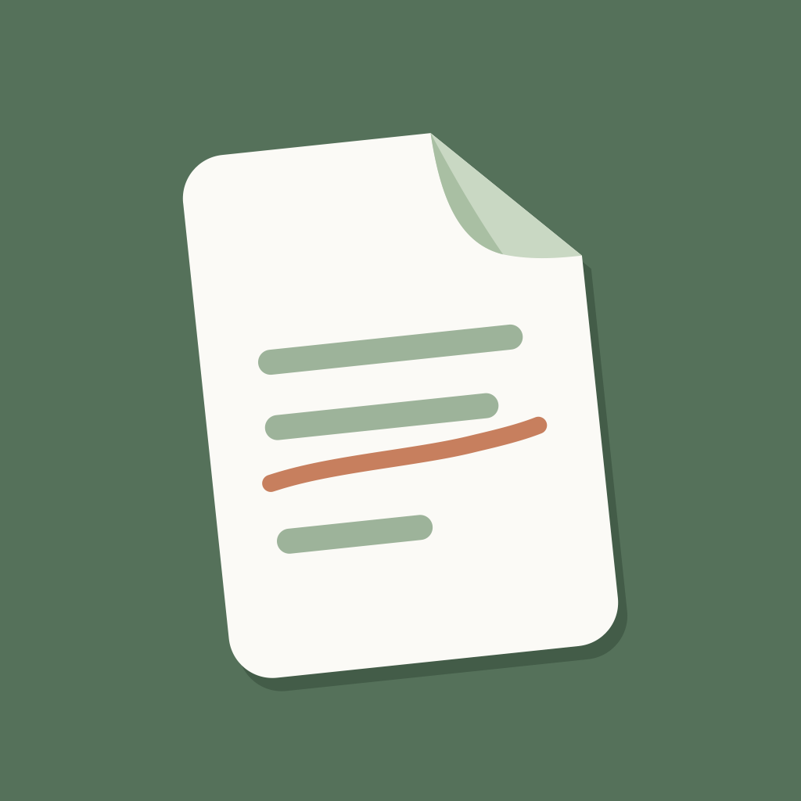
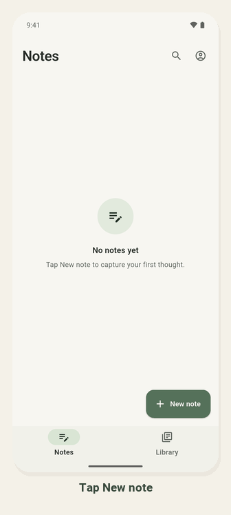
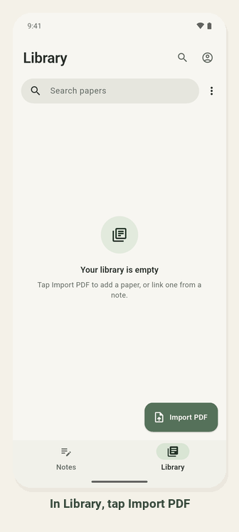
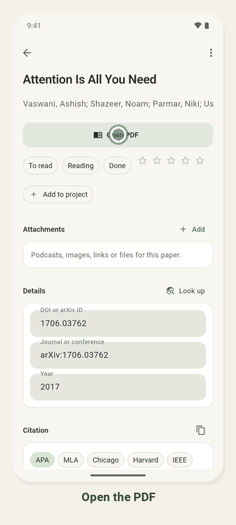
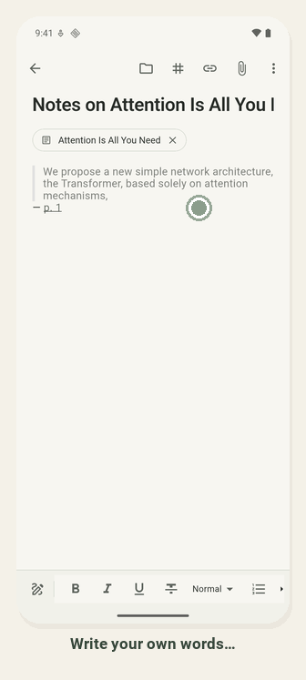
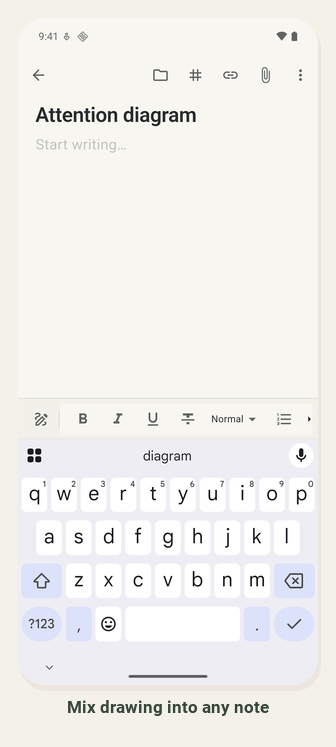

<p align="center">
  
</p>

<h1 align="center">Corplex</h1>

<p align="center">
  <b>Read, annotate, take notes and cite — in one calm place.</b><br>
  A notes and literature-review app for iPad, iPhone and Android.
</p>

---

Research tends to scatter: the PDF in one app, highlights in another, your
thoughts in a third, and the reference list rebuilt by hand at the end.
Corplex keeps that whole loop together. You read a paper, mark what
matters, pull it into your notes with a link back to the page, and cite it
— and the bibliography writes itself.

It works fully offline. Sync across your devices is there if you want it,
never required.

## How it works

<table>
<tr>
<td width="50%" align="center"></td>
<td width="50%">

### Capture a thought in seconds

Tap **New note**, give it a title and start writing. There's no save
button and no note "type" to pick — it saves as you type, and you can mix
text, headings, lists, quotes, images, audio and drawings in the same
note.

</td>
</tr>
<tr>
<td width="50%">

### Bring in a paper

In **Library**, tap **Import PDF** and pick the file. Corplex finds the
paper's DOI or arXiv ID (or its title) and fills in the authors, venue
and year by itself; if it can't, type the DOI and tap **Look up**. Every
citation style (APA, MLA, Chicago, Harvard, IEEE, BibTeX) is then ready
to copy.

You can also share a PDF or a link *into* Corplex from other apps, or
import a whole reference library from Zotero, Mendeley or
EndNote (BibTeX, RIS or CSL JSON).

</td>
<td width="50%" align="center"></td>
</tr>
<tr>
<td width="50%" align="center"></td>
<td width="50%">

### Read, highlight, quote

Open the PDF, press and hold to select a passage, then choose
**Highlight** or **Quote to note**. The quote lands in your note with a
**p. 1** link — tap it later to jump straight back to that page. The
paper reopens where you stopped reading. For a figure or table, choose
**More → Snapshot to a note** and drag a box around it.

On a big screen, **Read with a note** puts the PDF and your note side by
side, and quotes drop straight into the open note.

</td>
</tr>
<tr>
<td width="50%">

### Cite as you write

Type **[@** anywhere in a note to cite a paper from your library — it
shows as *(Vaswani et al., 2017)*, and tapping it opens the paper. When
you're done, choose **More → Add bibliography** and pick a style — the
reference list is written for you, and updated if you run it again.
Type **/** for everything else a note can do: draw, link a note, add a
heading, attach a file, start a literature-note template.

**More → Export** turns a note (or a whole project) into Markdown, Word
or PDF with the citations and references resolved.

</td>
<td width="50%" align="center"></td>
</tr>
<tr>
<td width="50%" align="center"></td>
<td width="50%">

### Think with a pen

Tap **Draw** to add a sketch anywhere in a note — with Apple Pencil, a
stylus, or your finger. Pen, highlighter and eraser, a few calm inks,
undo and redo. Once a pen touches the screen, your resting palm is
ignored. On iPad, Pencil double-tap follows your iPadOS setting.

</td>
</tr>
</table>

## And quietly, when you need them

- **Projects** — group the papers and notes for one review or chapter.
  Each project has its own page (how much you've read, its papers and
  notes) and a **synthesis matrix** (papers × themes like method,
  sample, findings) that you can fill from your highlights.
- **Write the thesis** — a project's notes become ordered chapters with a
  status (outline → final), word targets and a due date; see which papers
  you read but never cited, and every `TODO`, `[@?]` (needs a citation)
  and `[fig: …]` you left in the text.
- **Thesis finishing touches** — cite a specific page (long-press a
  citation, **Page…**, and *(Kandel et al., 2013, p. 42)* follows into every
  style); numbered figures and tables per chapter ("Figure 3.2") with
  references that stay right when things move; a list of abbreviations built
  from what you wrote, with a nudge wherever one isn't spelled out at first
  use in a chapter; and **versions** — a copy is kept when a chapter goes to
  your supervisor (or save one any time), to compare line by line or
  restore. Project exports open with lists of figures, tables and
  abbreviations.
- **Study details** — record species, brain regions, techniques, sample
  size and paradigm for each paper, filter the Library by them ("mouse
  2-photon studies with n ≥ 10"), and pull them into the synthesis matrix
  as ready-filled columns.
- **Search everything** — notes, papers and highlights, as you type, and
  find any phrase inside an open PDF.
- **Scanned papers too** — old or library-scanned PDFs are read on your
  device, so you can search, highlight and quote them like any other.
- **Follow the trail** — a paper's references and the papers that cite
  it, one tap from adding them to your library.
- **Map** — see how your notes and papers link and cite each other, for
  the whole library or one project.
- **Revisit highlights** — old highlights come back one at a time, less
  often each time you keep them, so what you read stays with you.
- **Audio** — attach a NotebookLM audio overview or a lecture recording,
  play it while you read, and drop tappable timestamps into your notes.
  It keeps playing with the screen off, with lock-screen controls.
- **Reading comfort** — sepia and night pages, a focus mode with nothing
  but the page, a strip of page thumbnails, marks down the edge showing
  where your highlights are, reading progress in the Library, the PDF's
  table of contents, star ratings, reading status, dark mode.
- **Writing comfort** — typewriter scrolling, word count and reading
  time, a preview card when you long-press a citation, and paste a DOI or
  arXiv link to add the paper and cite it in one go.
- **Maths** — type `$x^2$` or `$$` for equations; they print properly in
  PDF exports.
- **Voice notes** — record a thought while you read; on iPad and iPhone
  it's written out for you, on the device.
- **Any citation style** — APA, MLA, Chicago, Harvard, IEEE, Vancouver,
  Nature, Science, ACM and more, or add any `.csl` style file.
- **Take it with you** — export your PDFs with highlights as real
  annotations (Preview, Acrobat, Zotero see them), or your whole library
  as a Markdown folder for Obsidian.
- **Shortcuts** — long-press the app icon for a new note or a PDF import,
  a home-screen widget to continue reading or start a note, and share
  PDFs and links into Corplex from other apps.
- **Your data is safe** — deleted items go to a trash you can undo from,
  and you can back up everything to a single file and restore it.

None of this adds clutter until you use it: no badges, no banners, no
setup screens.

## Install

Corplex is in active development and not yet in the app stores.

- **Android** — test builds are published as APKs on the
  [Releases](../../releases) page when available; open one on your device
  (you may need to allow installing apps from your browser). Or build it
  yourself (below).
- **iPad and iPhone** — each release also has an unsigned `.ipa`. Install
  it with a free sideloading tool such as [Sideloadly](https://sideloadly.io)
  or AltStore, which signs it with your own Apple ID (the release notes
  walk through it). On iPad, Corplex uses a proper tablet layout: a side
  rail, and in landscape your list and the open note or paper side by
  side. An App Store release is planned.

## Sync between devices (optional)

Everything works without an account. To keep your library in step
across devices, Corplex can sync to your own free
[Supabase](https://supabase.com) project — your notes, papers and files
stay in a database you control. If you edit the same note on two devices
before they sync, both edits are kept. Sign in from the account button in the
top right; the setup for the server side is in
[`AGENTS.md`](AGENTS.md#status) under *Supabase config*.

## Build it yourself

You'll need [Flutter](https://docs.flutter.dev/get-started/install)
(3.47 or newer).

```sh
git clone https://github.com/scaling-physics/corplex.git
cd corplex
flutter pub get
flutter run                  # on a connected device or emulator
flutter build apk --release  # an installable Android build
```

To build with sync, add your project's URL and publishable key:

```sh
flutter run \
  --dart-define=SUPABASE_URL=https://<your-project>.supabase.co \
  --dart-define=SUPABASE_PUBLISHABLE_KEY=<your publishable key>
```

`flutter test` runs the test suite. How the app is built — the design
principles, architecture and decisions — is written up in
[`AGENTS.md`](AGENTS.md).
